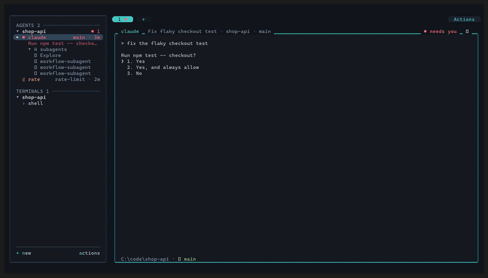

<h1 align="center">seshi</h1>

<p align="center"><strong>Every session, one calm place.</strong> Run lots of coding agents side by side, see which ones need you, and keep them going when you leave.</p>

<pre align="center">
███████ ███████ ███████ ██   ██ ██
██      ██      ██      ██   ██ ██
███████ █████   ███████ ███████ ██
     ██ ██           ██ ██   ██ ██
███████ ███████ ███████ ██   ██ ██
</pre>

<p align="center">
  <a href="#install">Install</a> ·
  <a href="#use">Use</a> ·
  <a href="#configure">Configure</a> ·
  <a href="#script-it">Script it</a>
</p>

<p align="center"></p>

<p align="center"><sub>Demo screens use synthetic project names, prompts, paths and agent output; no real session data is shown.</sub></p>

Run Claude Code, Codex, Gemini and friends side by side, see which ones need you, jump to them,
and keep them running when you close the window. Native on Windows, macOS and Linux (Omarchy
included). Inspired by [herdr](https://github.com/ogulcancelik/herdr),
[nebula](https://github.com/agentSystemLabs/nebula) and [fut](https://github.com/mikker/fut).

- **Agents keep running after you close the UI.** A background daemon owns every pseudoterminal
  (ConPTY on Windows). `<leader> q` detaches, and running `seshi` again reattaches.
- **Survives restarts.** Sessions are saved as they change; after a reboot `seshi` rebuilds them
  in the right folders and resumes agents (`claude --resume <id>`, `codex resume --last`, ...).
  Each pane's recent output is kept on disk too, so its history is still there to scroll
  back through, above a line marking the restart.
- **One screen for everything.** Choose **Cards** or **Flat** in Settings → Appearance → Layout.
  Cards (the default) shows a full-height sidebar, pill tabs and pane cards. Flat draws those
  same sessions and panes edge to edge, with square surfaces and a bottom status line; Tab and
  Shift+Tab move focus between the sidebar and panes, and Esc returns to the sidebar. The leader is
  `Ctrl+Space`: a sky-blue pill says it's armed, a pause shows the compact overview,
  and `?` opens the searchable **All shortcuts** reference.
- **Find anything.** `<leader> j` is the inbox: what needs you first, then type to go to any
  project or session. `<leader> Space` is a command palette in plain words, `a actions`
  at the foot of the sidebar lists common commands. `<leader> ?` lists every configured
  binding (including aliases), global shortcuts and controls inside each screen.
- **Status at a glance.** Working (amber, its name shimmering), needs you (red), done (green until
  you look), idle. An alert or a sound tells you when one needs you or finishes out of view.
  Click a sidebar status icon or pane status tag to see why, the evidence's age and any uncertainty.
- **Saved workflows.** Use your own planner, worker and reviewer profiles. Review the plan
  before approving it; build and review repeat for at most three rounds. Setup prepares
  repository instructions; sidebar stage labels and Inbox plan approvals keep progress visible.
- **Usage and limits.** Each agent's card shows how full its context is and what its session
  has cost, and its sidebar row shows the context once it's past half. An agent stopped by a limit
  is told "continue" once the limit resets (Settings → Continue after a limit). Claude's numbers
  come from its status line: `seshi integrate claude` makes seshi's run first and then yours,
  which looks the same as before.
- **Detection without setup.** The process tree finds `claude`, `codex`, `gemini`, `opencode`,
  `cursor-agent`, `copilot`, `amp`, `qwen`, `aider` and others, and screen patterns tell
  working from blocked. Hooks (`seshi integrate claude`) make it exact.
- **Subagents under their agent.** What an agent has running shows under its row
  (`↳ reconcile_audit`, repeats counted): Claude's from its hooks, Codex's from its session
  files (each subagent by its task's name, and `goal` while `/goal` is driving it).
- **Git without leaving.** New agents get their own worktree, including `claude` or `codex`
  typed into a shell in a repo's main folder (turn it off with *Own worktree per agent* in
  Settings; `--continue`/`--resume` stay put). Changes (`d`) shows the diff with
  review marks, then commit, merge, or open a pull request. Files (`f`), find (`F`), search the
  code (`/`), switch branch (`B`).
- **Everything is configurable.** The leader, every binding, commands bound to keys, themes and
  per-colour overrides, icons, the sidebar side, detection patterns and your own agents. Settings
  (`<leader> ,`) save to your config with its comments kept.
- **Scriptable.** `seshi split -- claude`, `seshi send`, `seshi read` and `seshi ls --json`
  work from any shell, including from an agent running inside seshi.

## Install

**macOS, Linux, Omarchy / Arch:**

```sh
curl -fsSL https://raw.githubusercontent.com/CydoEntis/seshi/main/install.sh | sh
```

**Windows (PowerShell):**

```powershell
irm https://raw.githubusercontent.com/CydoEntis/seshi/main/install.ps1 | iex
```

The installers pick the build for your machine, check its checksum, put it in
`~/.local/bin` (Windows: `%LOCALAPPDATA%\Programs\seshi`, added to your PATH) and tell you if
another `seshi` comes first. No admin rights needed. `SESHI_VERSION=v0.3.0` picks a version;
`SESHI_INSTALL_DIR` a folder. If scripts are blocked (a locked-down work PC), download the archive
for your machine from [Releases](https://github.com/CydoEntis/seshi/releases) and put `seshi` on your PATH.
To update later: Seshi checks each time you open it (and every few hours while it stays
open). When a newer version is out, dots beside **Actions**, its **Settings** row and the
**General** tab guide you to **Update now** (also "Update seshi" in the command palette).
Review the version and release notes, then confirm to install. The current window and daemon
keep running. Settings shows **Installed here**, **This window**, **Running daemon** (or the
remote host), and **Restart pending** until those versions match. After active tasks finish,
restart the daemon with `seshi kill-server`, then reopen `seshi` to load daemon fixes.
Stopping the daemon stops its processes; saved sessions are restored on reopening. From a
shell it's `seshi update` (or `seshi update --check` to just
look). To look right now, Settings has **Check for updates** by the version when no newer one is
known (also in the command palette). Turn the automatic check off in Settings (Check for updates).

**Coming from hydra?** Seshi is its new name. Install seshi as above; the first time it starts,
it brings hydra's config, saved sessions and history over (hydra's own folders are left as they
were), and the next server start points your Claude hooks at seshi. Run `seshi integrate mcp` again
if agents used hydra's MCP tools, then uninstall hydra when you're happy.

Then run `seshi doctor` to check your setup. For the best look: a terminal with true colour and a
[Nerd Font](https://www.nerdfonts.com) (Windows Terminal, Ghostty, Alacritty, WezTerm, iTerm2).
Optional: `git` (worktrees, changes), `gh` (opening a pull request from Changes).

From source (any platform with Rust): `cargo install --git https://github.com/CydoEntis/seshi`.

## Use

Click **Actions** at the top right (also at the foot of the sidebar) to open
**Profiles**, **Workflows**, **Workflow runs**, **Set up agent status**, Settings
or **All commands**. The top button stays available with the sidebar hidden or
no sessions open. All commands supports clicking rows and scrolling with the wheel,
including configured custom commands.

```sh
seshi            # attach (starts the server if needed); opens the current dir
seshi ~/code/api # open or switch to that directory
```

Agents come first in the sidebar, then terminals, then sessions on other machines (SSH). They are
grouped by **where they are working now**: the git
repo they're in (a subfolder counts as its repo) or the folder itself outside git, and for SSH
the machine they're connected to. Nothing to open or set up: `cd` somewhere in a shell and it moves
to that group; start an agent in a shell (or ssh somewhere) and it moves section. An agent stays in
the group of the folder it started in while it runs, however many folders it works in. A pane
split beside a session stays with it.

```
╭──────────────────────────────╮
│                              │
│  ● shop-api              ● 1 │
│   ● claude      main · 3m    │
│     Allow running npm test?  │
│   ⠹ calm-heron          2m   │
│   › shell                    │
│                              │
│  ● web-shop                  │
│   ✓ quick-fox          40s   │
│                              │
│  ──────────────────────────  │
│  + new             actions   │
╰──────────────────────────────╯
```

- A project is its dot (in its colour) and name; `● 1` on the right when something there needs
  you, `no git` outside a repo.
- Under it, its sessions: state, name, `branch · age` on the right. A session that needs you has
  its question under it. Every new claude / codex gets its own worktree (named for you), so agents
  never edit the same files.
- The active session keeps its selection fill and **▸** marker as you move the mouse.
  Hover is a quieter fill; keyboard browsing uses **›** independently, including on sleeping rows.
- Hiding the sidebar leaves a slim rail with status indicators and two-letter titles.
  Click to switch sessions, hover for full names, scroll to reach more, and use the
  chevron to expand. Its red count includes blocked agents outside the visible rows.
- Things that need you sort to the top; everything else keeps its place. A session left asleep
  by an older Seshi version shows `zzZ … asleep`; open it to resume the conversation. The saved
  terminal screen stays visible while you browse the session.
- A session taking a real share of the machine says so in its pane's title, beside its state
  (`▲ 38% CPU · 2.1 GB`, from a fifth of the CPU or two gigabytes).
- An agent's subagents are listed under its row; the `▾ 3 subagents` heading (or **Hide
  subagents** in its menu) folds them away.
- The sidebar's foot: **+ new** opens a plain shell, just like `Ctrl+Space n`;
  **actions** lists common commands (settings included); **All keys** opens the full reference.
- `⇆` under a row names a file that this checkout and another have each changed since their
  branches parted (a merge conflict waiting to happen); more than two are one line with a count.
- Drag a group's name, or a session, up or down to reorder (what needs you still comes first);
  drop a session on another group (its name or one of its sessions) to move it there, within its
  section. Click to fold or open. With the sidebar focused
  (`Ctrl+Space e`), a row's menu letters work directly (the sidebar's foot lists them): `x` (or
  Delete) asks to close, `r` renames. Settings distinguishes installed, window and daemon versions.

The leader key is `Ctrl+Space`. Press it and a sky-blue pill appears at the end of the tab row
(the pane you're in turns sky too); press a key, or wait a moment for the compact key map.
In that overview a key runs its command, Tab searches leader commands, and keys marked `›` open a
second step (`w` worktrees: new, switch, merge, delete; Backspace goes back).
Press **Ctrl+Space**, release, then **?** for **All shortcuts**. Type to find a key,
action or screen; arrows, page keys, Home/End and the wheel scroll. It uses your actual
bindings, preserves aliases and includes shortcuts that work without the leader.
See [contextual shortcuts](docs/shortcuts.md) for every screen's controls, also shown in-app.
The table below lists the default leader bindings; custom bindings appear in All shortcuts.

| keys (after the leader) | action |
|---|---|
| `j` | **inbox**: what needs you (answer a question with its number, Enter goes there), then every session; type to find one |
| `m` / `i` | follow-up to the current agent / explain its status |
| `n` / `p` | a shell right where you are (cd and run what you like; it groups itself) / a shell beside this one |
| `c` | start a fleet: a goal, and the agent that commands it |
| `z` (or `b`) / `x` | hide or show the sidebar / close |
| arrows | focus the pane that way (left past the edge: the sidebar). `Alt`+arrows do it without the leader (Settings → General turns that off) |
| `v` or the pipe key (Shift+backslash) / `-` / `H J K L` | split right / split down / resize left, down, up, right |
| `t` / `r` / `]` `[` / `X` | **tabs**: new tab (a shell where you are) / rename it in its pill (or double-click it) / next, previous / close it. `Alt+1`–`9` (no leader) goes to a tab |
| `w` / `f` / `d` | worktrees › / files / changes |
| `W` | open the worktree picker directly; choose a worktree or type a new branch |
| `e` / `Space` or `:` / `a` | focus the sidebar / command palette / actions |
| `F` / `/` / `B` | find a file / search the code / switch branch |
| `R` / `V` | rename a session / paste the clipboard's image |
| `y` / `{` `}` / `PageUp` `PageDown` | select text with keys / previous, next command in history / scroll half a pane |
| `,` / `?` / `N` / `q` | settings / All shortcuts / notification history / detach (agents keep running) |
| `Ctrl+R` | reload configuration |
| `Ctrl+Space` | send the configured leader key to the program |
| `Ctrl+V` | paste the clipboard's image (alias for `V`) |

Without the leader: **Alt+1–9** selects tabs; **Alt+arrows** moves pane focus
when enabled in Settings. All shortcuts shows changes to these bindings too.

In **Files**: Enter puts the path in the agent's prompt, `e` opens it in your editor (`editor`
in config; nvim, helix … open inside seshi), `y` copies the path. In **Changes**: `c` commit,
`p` push and open a PR, `e` editor, `x` mark the file reviewed (it sinks; the mark clears
if the file changes again), `r` goes to its agent.

Everything also works with the mouse. Hold Shift to select text with your terminal.

## Panes are real terminals

- **Scroll:** the wheel, or `PageUp` / `PageDown` at a prompt (full-screen programs keep those
  keys). Outside full-screen mode, `Shift+PageUp` / `Shift+PageDown` scroll half-pages and
  `Ctrl+Shift+Up` / `Ctrl+Shift+Down` scroll individual lines. A scrollbar shows when there's history;
  click or drag it. Typing (or clicking for the program) goes back to the bottom.
- **Mouse:** programs that use it (vim, lazygit, htop, full-screen agents) get clicks, wheel and
  drags. Hold Shift to select text yourself.
- **Copy:** drag to select; double-click copies a word, path or link. Programs that copy (OSC 52,
  e.g. Claude's `/copy`, nvim) put it on your clipboard. Ctrl+click opens a link.
- **Images:** `Ctrl+Space V` (or `Ctrl+Space Ctrl+V`, or a paste while an image is on the
  clipboard) saves the image and pastes its path; Claude Code and Codex attach it.
- **Keys:** on Windows, combos plain terminals can't send (Ctrl+Shift+letter, Ctrl+Enter, Ctrl+Tab)
  reach programs exactly, as native key records. Shift+Enter is still a newline for agents.
- **Resize:** text re-wraps to the new width (history included). Programs' cursor shape (bar,
  block, underline) shows. Synchronized redraws are drawn whole, so agents don't flicker.
- **Closing** a pane ends everything running in it after you confirm.

## Alerts

Questions ring even in the focused pane; completion rings when you're away from it.
Seshi uses two rising notes for needs you and one for finished, with an in-app note for
other panes. Needs you is said at once. Finished waits one second and is only said if the agent is still finished then, so one
that carries on by itself stays quiet; a session another agent started isn't said when it
finishes at all, since that agent is the one waiting for it. With no seshi window
open, the server plays the sound and shows a desktop notification instead. `[notify] sound =
false` (Settings → Alert sounds) turns the sounds off; `seshi test-alert` plays them.

**On your phone** (off until you set it up): install the free [ntfy](https://ntfy.sh) app (no
account), subscribe to a topic name nobody would guess, and put it in Settings → Phone alerts
(`[notify] phone_topic`). An alert goes once an agent has needed you for a minute with nobody
answering (`phone_after`), so it stays quiet while you're at your desk; `phone_done` adds
finished ones. Alerts say which agent and where; `phone_text` adds what it's doing. On the
public server the topic name is all that keeps them private (`phone_server` for your own).
`seshi test-alert` sends a test.

Click a notification to go to its session: seshi comes to the front on it (its split too).
That works for the note inside seshi and the desktop notification on Windows and Linux (on
Omarchy / Hyprland the window is brought forward too); on macOS, install
`terminal-notifier` for clickable ones.

## Resuming older sleeping sessions

Seshi no longer stops idle agents automatically; they keep running until you close them or
their own agent process exits. If a session was already asleep under an older Seshi version,
open it to resume its conversation (`claude --resume`, `codex resume`). Recovery shows its
saved terminal screen without a separate wake screen or animation.

## Settled and snoozed

An agent that has sat finished or idle for `settle_after` (default `"3d"`; `"never"` turns it
off), or whose branch's commits have all landed somewhere else with nothing uncommitted, folds
into a **settled** line at the foot of its project. Click the line (or **Show settled** in the
project's menu) to unfold it. A settled session comes back by itself when it works again,
needs you, or you open it.

**Snooze…** in an agent's menu sets it aside yourself: for an hour, four hours, a day, or
until it has something for you. A snoozed agent comes back when the time is up, and at once
if it needs you: one that's waiting on you is never out of sight. (A branch merged by squash
leaves no trace git can see, so that one settles on the idle timer.)

## Follow-ups and snapshots

`m` on an agent's row writes it a follow-up without leaving where you are. While the agent is
working, Enter leaves the message with seshi and it's typed in when the turn is over (never
into a question the agent is asking); Ctrl+Enter sends it at once. What's waiting shows under
the row, and the row's menu drops it.

Each time an agent's turn begins, seshi keeps the checkout's files as they are (tracked or
not; never what git ignores). **Snapshots…** in the agent's menu lists the last nine;
picking one puts the files back as they were then. What's there now is kept as a snapshot
first, so a restore can be taken back the same way. Snapshots are commits under the
worktree's own refs (`refs/worktree/seshi/snapshots`): no branch, nothing in your history,
your staging untouched, the newest 30 kept. `[snapshots] enabled = false` turns them off.

## Merging

In Changes, `m` merges a worktree's branch into the main one, then closes its
sessions and removes the worktree and the branch. Closing the last session in a worktree
seshi made removes the folder; its branch goes too when it's already merged.

## Recipes

```toml
[[recipes]]
name = "feature"
worktree = true                           # its own worktree
run = ["claude", "npm run dev", "lazygit"] # the first is the main one
```

They show up in + New as `⚙ feature`.

## Agents that steer agents (MCP)

```sh
seshi integrate mcp     # registers `seshi mcp` with Claude Code (prints the Codex snippet too)
```

Any agent can then use seshi's tools: `seshi_list` (sessions, status, the question each is
asking), `seshi_read` (a screen), `seshi_send` (type a message), `seshi_answer` (a numbered
prompt), `seshi_start` (a new agent in its own worktree; your screen stays where it was) and
`seshi_interrupt`. There is no merge, push or delete.

You decide how far that goes (Settings → Agents, or `[mcp]`):

```toml
[mcp]
approve = "never"    # never | safe | always: may agents answer "yes" to other agents' prompts?
safe = ["npm test", "cargo test", "git status"]   # with "safe": only prompts that mention these
scope = "project"    # project: only sessions in the calling agent's repo | all
```

## Fleets

Give one agent a goal and let it run the others. **Start a fleet** (`<leader> c`, or in `actions`) asks for the
goal and which agent is the **commander**; the commander splits the work up, starts helpers in their
own worktrees, checks what comes back and reports to you. Helpers sit under their commander in the
sidebar, and one that needs you still goes to the top.

An agent you're already talking to can take over as commander: **Fleet commander** in its row's
menu (it asks first). The commander's instructions are `seshi brief`: read them, or tell any agent to "run seshi
brief and follow it". It works best with seshi's tools set up (`seshi integrate mcp`); without them the
commander uses the `seshi` commands from its shell. With a plan and tickets in the repo, a goal like
"work the active phase" has it take them in order, one helper per ticket.

Only so many helpers work at once (four, or what Settings → Agents → Helpers working at once
says; 0 is no limit): each runs builds and tests of its own, and a commander that asks for more
is told to wait for one to finish.

## Sync between machines

```sh
seshi sync setup          # first machine: makes a private GitHub repo seshi-config
seshi sync setup          # other machines: picks it up (your old config is kept as a backup)
seshi sync                # pull + push now (it also happens on its own)
```

Shared: `config.toml`. Anything for one machine only (a shell path, keys) goes in
`config.local.toml` next to it, which is never synced and wins over `config.toml`.

## Splash and settings

seshi opens on the splash: the seshi, what happened while you were away (`● 2 need you ⠹ 3 still
working ● 1 finished`) and buttons: Resume where you left off (`r`), New session (`n`).
Turn it off in Settings → General. Settings → General → Start folder sets where plain `seshi`
opens (e.g. `~/code`); empty means wherever you run it.

`Ctrl+Space ,` opens **Settings** in a right-hand drawer that slides beside the panes
(on a narrow window it uses the pane column). Sections (Tab cycles): General ? Sessions ? Appearance ? Agents ?
Keys. Values are chips you click (or ←→ / Enter). Appearance has **Layout** (Cards or Flat),
Cards pane controls and a **Theme**
browser. **Working spinner** previews Braille, Dots, Line (ASCII), Circle, Arrows,
Pulse, Blocks and Static. Choose **Custom** to type or paste space-separated frames.
Each frame must fit one terminal column; up to 64 frames are supported. Enter
applies the choice, Esc cancels, and the change takes effect immediately.

The Theme control opens a browser of 65 themes. Type a name or flavor to filter, use arrows or
PgUp/PgDn to move, and preview the palette before pressing Enter to apply it. Click a row
to preview and click it again to apply; Esc returns without changing your theme.

The catalog includes all four Catppuccin flavors, Gruvbox Dark/Light, Nord, Dracula,
Tokyo Night Night/Storm/Moon/Day, Solarized Dark/Light, One Dark, One Half Dark/Light,
Kanagawa Wave/Dragon/Lotus, Ayu Dark/Mirage/Light, Night Owl, Nightfly, Moonfly,
Everforest Dark/Light, Rosé Pine/Moon/Dawn, Cobalt2, Jellybeans, Iceberg, Sonokai,
Shades of Purple, Panda, Lucario, Gotham, Apprentice, and Zenbones Dark/Light, alongside
Seshi Dark (the default) and Seshi Light, Seshi Walnut/Night/Day, Harbor/Day, Moss/Day, Ember/Ash,
Ink/Paper, Arcade, Hydra, Tinkery/Light, Aurora, Moonlit, and the existing themes. [Palette sources and variant notes](docs/theme-sources.md).
New palettes theme ANSI agent output; explicit RGB output keeps the program's colors.
UI text and status colors are adapted for contrast. Existing theme overrides remain active.
On Keys, Enter then press a new key to rebind a shortcut. Changes save to `config.toml`
with comments preserved and apply at once.

## Command name clash

`seshi` is also the name of a Linux password-testing tool (THC-Seshi). If you have that installed,
give this one its own name; the app doesn't care what it's called:

```sh
alias hy='~/.cargo/bin/seshi'                          # bash / zsh
Set-Alias hy "$env:USERPROFILE\.cargo\bin\seshi.exe"   # PowerShell ($PROFILE)
```

## Configure

**Agent profiles:** press **Ctrl+P** in **New**, or choose
**Agent profiles** in the command palette. Create personal Claude Code / Codex
roles, override them per project, and export native agent files for your
workflows. Editable Planner / Worker / Reviewer starters are included.
Enter or double-click edits a role; **Launch** (`l`) opens a task chooser.
See [agent profiles](docs/features/agent-profiles.md).

**Workflows:** open **Workflows** in the command palette or profiles sheet.
Select your planner, worker and reviewer profiles, then choose **Setup** (`u`).
Review and **Copy instructions** (`c`), paste them into `AGENTS.md` or `CLAUDE.md`,
and ask existing sessions to read the updated instructions. Their ordinary implementation
requests can then select your saved workflow. Setup previews instructions; it does not edit files.
Enter or double-click edits a workflow; click its role fields to choose profiles.
Choose **Run** (`s`), enter a task, then Enter to start. Review its plan
from **Inbox → Review plan** or **Runs**, then explicitly **Approve plan** (`a`).
Build/review repeat for up to three rounds in one task worktree. The sidebar shows
planning, building/reviewing round and questions; click a workflow label to open its run.
Profiles, Workflows and Runs share a drawer on the right, with the work visible beside it.
Click tabs, use Tab/Shift+Tab from lists, or Ctrl+Tab/Ctrl+Shift+Tab from any section.
Switching sections keeps your draft and position. Open a run with Enter to read its
Goal, Plan, Build and Review reports; **Open pane** is separate. Esc goes back first.
See [setup, prompts and recovery](docs/features/workflows/usage.md).

```sh
seshi config init   # writes the annotated example to the config path
seshi config path   # %APPDATA%\seshi\config.toml, or ~/.config/seshi/config.toml
```

See [`config.example.toml`](config.example.toml) for every option. Some highlights:

```toml
prefix = "ctrl+a"
theme = "tokyo-night"          # browse all choices in Settings > Appearance > Theme

[theme_overrides]
accent = "#ff9e64"

[keys.prefix]
C = "spawn-right:claude"       # any command, in a split or a new tab
g = "spawn-tab:lazygit"
x = "none"                     # unbind a default

[keys.global]                  # no prefix needed
"alt+h" = "focus-left"

[[agents]]                     # teach it a new agent, or tune a built-in by name
name = "my-agent"
process = ["my-agent"]
working_patterns = ["esc to interrupt"]
blocked_patterns = ["\\(y/n\\)"]
```

## Never leave seshi

| Leader + | Panel | What it does |
|---|---|---|
| `f` | **Files** | *Recent*: files that just appeared in Downloads, Desktop, Documents or the project (docs, zips, screenshots). *Project*: fuzzy search over the project's files. Enter types the path into your prompt; `^O` opens it, `^F` shows it in the file manager, `^Y` copies the path. |
| `d` | **Changes** | A worktree's changed files and the diff: `c` commit, `m` merge into the base branch, `p` push and open a pull request, `r` go to its agent, `x` throw it away. |

Typing in a panel filters it; the action keys that would collide with typing use Ctrl.

## Agents

The new-agent dialog starts any agent in `[quick] agents`; `{prompt}` is the task, quoted for
your shell. Agents are just commands, so anything works:

```toml
[quick]
agents = [
  { name = "claude", command = "claude {prompt}" },
  { name = "codex", command = "codex {prompt}" },
  { name = "opus", command = "claude --model opus {prompt}" },
]
```

### Accounts

An agent entry with an `env` of its own is an account: the same agent, signed in as someone
else. It shows up wherever you pick an agent, and a session keeps its account through sleep,
a move to another worktree, and a restart.

```toml
[[quick.agents]]
name = "claude work"
command = "claude {prompt}"
env = { CLAUDE_CONFIG_DIR = "~/.claude-work" }
```

Set one up once, from any terminal: `seshi account "claude work" -- claude` to sign in, and
`seshi account "claude work" -- seshi integrate claude` so that account reports its status
to seshi too. When one account hits its limit, start the next session on the other.

## Restarts

The session (workspaces, tabs, splits, each pane's directory and command, agent sessions) is
saved to the data directory a couple of seconds after it changes. On the next start:

- Panes reopen in their last known directory. For PowerShell, that requires your prompt to report it
  via OSC 7 or OSC 9;9, as oh-my-posh and starship can. Other shells are tracked automatically.
- Agents resume. With hooks installed, seshi knows the exact session (`claude --resume <id>`).
  Otherwise it uses the agent's "most recent" form (`claude --continue`, `codex resume --last`).
- Panes started with a command (`spawn-right:lazygit`, `seshi split -- x`) run it again, except
  an agent's: `codex "<task>"` would start the task over, so an agent that can't be resumed
  opens as a shell.

`seshi kill-server` keeps the session for next time, and `seshi kill-server --forget` discards it.
Closing every pane yourself also starts fresh. A burst of panes dying at once, as at logoff or a
crash, is not recorded, so the last good layout survives. Configure all of this under `[restore]`,
and per agent with `resume` / `resume_last`.

## Worktrees

```sh
seshi worktree feat/login -- claude      # new branch from HEAD, opened with claude running
seshi worktree fix-123 --base origin/main
seshi worktree-remove [--force]          # closes the workspace and removes the checkout
```

New worktrees go to `{repo_parent}/{repo}-worktrees/{branch}` (set `[worktree] dir`). An existing
local or `origin/` branch is checked out instead of created. Set `[worktree] command = "claude"`
to start an agent in every new worktree.

With **Own worktree per agent** enabled (the default), typing `codex` in a Seshi
shell in the main checkout creates a worktree, including with `-c` configuration
or `-p` profile options. `codex resume` and `codex fork` stay in the current folder;
explicit `--cd` and Codex's own `--worktree` are honored. Starting inside an existing
linked worktree reuses it. This shell integration applies to shells opened by Seshi.

**Cleaning up.** Closing the last session in a worktree seshi made removes its folder (never
with uncommitted changes; the branch is kept unless it's merged). One left behind by a session
that crashed is removed the same way a few minutes later, once nothing in it exists only there.
For everything else there is **Clean up worktrees** (a project's menu, or the command palette):
every worktree of the repo with why it's still around (in use, uncommitted changes, not merged,
when it last committed). The safe ones come ticked; tick any others, and one confirm removes
them. It says so first when ticked ones hold uncommitted changes, which would be lost.

## Copy mode

| key | |
|---|---|
| `h j k l`, arrows, `w b`, `0 ^ $`, `g G`, `H M L` | move |
| `Ctrl-u/d`, `Ctrl-b/f`, `PgUp/PgDn`, wheel | scroll |
| `v` / `V` | select characters / lines |
| `y`, `Enter` with selection | copy selection and leave; without selection, `y` copies the line and Enter exits without copying |
| `/` `?` then `n` `N` | search forward / backward (smart case) |
| `Tab` / `Shift+Tab` | keep this selection and go to the next / previous pane of the split, the same search there; `y` then copies them all, each under its pane's name |
| `q`, `Esc` | leave |

`Esc` clears an active selection before exiting; **Ctrl+C** exits immediately.
Without a selection, `y` or `Y` copies the current line; Enter exits without copying.
**Ctrl+Y / Ctrl+E** scroll one line up / down. Full details: [Copy mode controls](docs/shortcuts.md#copy-mode).

Copies go to the system clipboard and, through OSC 52, to your outer terminal (works over SSH).

## Agent status

Each pane's process tree is scanned about once a second. Detected agents get a status from
these sources, in order:

1. **Native hooks** report lifecycle events. `seshi integrate claude` adds hooks to `~/.claude/settings.json`.
   They stay inert outside seshi panes and are tagged so a re-run or `--uninstall` replaces them cleanly.
   Any tool can report its own state with `seshi hook <name> --status working|blocked|done|idle`.
   `seshi integrate gemini` and `seshi integrate qwen` do the same for Gemini CLI and Qwen Code;
   `seshi integrate opencode` writes a small OpenCode plugin that tells seshi what it's doing.
   `seshi integrate pi` installs Pi's native extension. These, and Codex's hooks, can also
   be installed with the mouse through **Actions → Set up agent status**. Restart Codex or
   OpenCode after setup, or reload Pi. Status follows the app with any provider, including
   z.ai and DeepSeek; see [status setup and requirements](docs/agent-status.md).
   For Codex, `seshi integrate codex` adds native `SubagentStart` / `SubagentStop`
   hooks in `~/.codex/config.toml`, so helper events carry their parent session ID;
   it also configures `notify` when free, preserving another program's notify.
2. **Screen evidence**: 22 pinned Herdr manifests match live screen regions, OSC
   titles/progress and paired dialog controls. A fresh visible blocker can override
   non-authoritative hook state; a transcript viewer preserves the previous state.
3. **Activity**: recent output that isn't the echo of your own typing.

A turn that finishes while you're looking elsewhere is **done** until you focus that pane.
An unanswered Codex queued or expanded question takes priority over its working spinner and shows
**needs you**. Finished prose that mentions the interrupt shortcut does not count as active
work. Codex reports turn completion through its notify hook; Seshi detects the next
turn's activity footer, including soft wraps and background-terminal details. New
input after a finished turn allows work detection immediately or after a delayed start.
An advancing footer also detects automatic follow-up work without keyboard input.
Native Codex subagent hooks attach every helper to its parent pane as soon as it
starts and remove it when it stops.
Hook authority ends when a recognized agent's process exits. Seshi recognizes
Herdr's 24 agent identities plus its five additional existing agents; OMP,
Mastracode, Kilo and Kimi native status setup is also available through Actions.
See the [pinned source audit and compatibility limits](docs/herdr-status-audit.md).
Terminal bells do not replace the status icon or add musical-note history entries.
Click a status icon/tag (or `<leader> i`) for a plain-language explanation and the ages of
hook, screen and process evidence; a status without confirmation is shown as uncertain.

**An agent seshi doesn't know** (a newer CLI, or one you start with your own alias): right-click
its pane and pick **"… is an agent"**, or run `seshi teach` in it (`seshi teach 4` for pane 4).
Seshi looks at the program actually running, whatever alias started it (or, for a node /
python harness, its package or script), and adds it under `[[agents]]` in your config with the
usual screen signs of working. Edit that entry to tune them.

## Popups

`seshi popup -- fzf` (or `lazygit`, `htop`, any command) opens a floating pane over everything,
in the folder you're in; it has the keys until the command exits, then it's gone.

## Agents asking you

An agent (or any script in a pane) can ask you something with fixed answers and wait:

```sh
seshi ask-human "Deploy to staging?" -o Yes -o "Not yet"   # prints the answer you pick
```

The pane shows **needs you** (with a notification), the question is in the Inbox and on the
pane's answer bar, and a number or click answers. Without `-o` the answers are Yes / No.

## What agents may do

A command an agent runs in its pane (the `seshi` CLI, or `seshi mcp`) acts as that pane, and a
pane may by default **read** other panes, **write** (type) into them and **start** sessions. To
also **respond** (answer another agent's prompt or question) or **admin** (close other panes,
stop seshi), grant it: `seshi grant 4 read,write,start,respond` (`seshi grant 4 default` puts it
back), or change the default in `[mcp] grants`. Only you can grant: not from inside a pane. These
are guardrails for agents that behave, not a sandbox.

## Script it

```sh
seshi ls [--json]                      # tree of workspaces / tabs / panes with agent status
seshi split [--down] [-p ID] -- codex  # inside a pane, targets that pane by default
seshi send -p 3 "run the tests"        # types text and presses Enter
seshi read 3                           # the pane's screen as text
seshi new ~/code/web -- claude
seshi worktree feat/x -- claude        # worktree workspace for this pane's repo
seshi focus 3 | close 3 | kill-server [--forget]
seshi send -p 3 --wait "fix the bug"   # waits for the turn to end, prints the agent's reply
seshi wait -p 3 [--regex "passed"]     # the turn ending, or text on the screen (exit 2: timeout)
seshi worktree --move [name]           # run by an agent: move itself into a new worktree
seshi doctor                           # check everything seshi relies on
seshi brief                            # a commander's instructions: how an agent runs a fleet of helpers
seshi --remote me@box                  # the UI here, agents on another machine (any command)
```

`SESHI_SOCKET=name` runs a separate server, like `tmux -L`.

## How it works

```
seshi (TUI client) ──┐      named pipe (Windows) / unix socket
seshi ls/send/hook ──┼──►   seshi daemon
                      │        ├─ workspace / tab / split-tree model (source of truth)
                      │        ├─ one PTY per pane (portable-pty → ConPTY / openpty)
                      │        │    reader thread → vt100 parser + replay ring
                      │        ├─ answers terminal queries (DSR/DA) itself, even with nobody attached
                      │        ├─ process-tree scanner (sysinfo) → agent detection
                      │        └─ status machine: hooks > screen patterns > activity
```

- `src/daemon/`: event-loop actor; PTYs (`term.rs`); process scan (`scan.rs`); session file
  (`persist.rs`); git status and worktrees (`git.rs`)
- `src/client/`: event loop, keys, actions (`mod.rs`); drawing (`render.rs`); copy mode (`copy.rs`)
- `src/protocol.rs`: length-delimited MessagePack messages
- `src/layout.rs`: split tree, rects, neighbour search
- `src/config.rs`, `src/keys.rs`, `src/theme.rs`: everything user-facing

## Per-repo settings: `.seshi.toml`

`on_create` runs in a new worktree before anything starts in it, so an agent begins with the
install done and the `.env` in place rather than halfway through.

Commit one to the repo:

```toml
[hooks]
on_create = "npm install"        # in every new worktree
on_remove = ""
```

Hooks don't run until you allow them: run `seshi allow` in the repo (it shows the
commands). If they change, they wait for `seshi allow` again, so a cloned repo can't run
code on its own. A hook is stopped after 10 minutes.

## Remote

`seshi --remote me@box` runs the UI here and everything else there, over ssh (seshi must be
installed on both; `SESHI_REMOTE_CMD` if it isn't on the far side's PATH, `SESHI_SSH="ssh -p
2222"` for options). Panes, agents, worktrees and statuses work; views that read files (Files,
Changes, find, branches) don't yet.

## Roadmap ideas

- Restore scrollback contents after a restart, not just the layout
- Files, Changes and find over `--remote`
- Workspace templates
